  
  
  
  
  

## `> about`

Software Engineer in Cairo building **production-grade backend systems for AI-driven products** — APIs, microservices and event-driven architectures.
Currently at **[Xplain AI](https://getxplain.ai)**, working across ~20 FastAPI microservices on Kubernetes that serve an AI learning platform to **15,000+ kids**.
Off the clock: competitive programmer, **ACPC Finalist**, and problem setter for ICPC-style contests.

## `> experience`

| When | Where | What |
|:--|:--|:--|
| **Jul 2026 – now** | **Xplain AI** · Software Engineer | AI learning platform — bilingual EN/AR lessons with narration & illustrations. FastAPI microservices on K8s + ArgoCD GitOps, event-driven Gemini pipeline (ARQ · Redis · S3). Fixed a Premium→Free entitlement revenue leak. |
| **Aug 2024 – now** | **Shipd** · Problem Author | 60+ hard problems & 90+ optimized solutions for AI model training. |
| **Nov 2025 – Mar 2026** | **Rehabitaire** · Software Engineer | AI physical-therapy platform on NestJS · PostgreSQL · Prisma · Redis. JWT + OTP auth, real-time SSE notifications, Strategy-pattern storage (local ↔ S3), Playwright E2E + CI/CD. |
| **Aug – Oct 2025** | **ECS** · Backend Developer | AI procurement system (Flask · PostgreSQL) + supplier-recommendation chatbot. RBAC, and a critical process cut from **7 min → 9 s**. |
| **Nov 2024 – Jan 2025** | **Quick R** · Freelance | Multi-restaurant digital menu platform end-to-end on .NET · MySQL · AWS. |

## `> projects`

<table>
  <tr>
    <td width="50%" valign="top">
      <b>🧠 Character Simulation System</b> 
      GRADUATION PROJECT · A+ (98/100)  
      Persona-simulation chatbot on fine-tuned <b>Mistral 7B (LoRA)</b> with a <b>RAG</b> memory layer for coherent multi-character conversations.  
      <code>FastAPI</code> <code>LangChain</code> <code>FAISS</code>
    </td>
    <td width="50%" valign="top">
      <b>🧩 Copy for Claude</b> 
      OPEN SOURCE · MERGED PR  
      Contribution to the VS Code extension — reviewed and merged upstream.   
      <code>TypeScript</code> <code>VS Code API</code>
    </td>
  </tr>
  <tr>
    <td width="50%" valign="top">
      <b>🌐 Social Media Platform</b> 
      SPRING BOOT MICROSERVICES  
      Microservice-based social platform with JWT auth and JPA persistence.  
      <code>Java</code> <code>Spring Boot</code> <code>Microservices</code>
    </td>
    <td width="50%" valign="top">
      <b>💬 3l sari3</b> 
      FULL-STACK · REAL-TIME  
      Self-destructing real-time chat channels with presence and expiry events.  
      <code>Node.js</code> <code>Express</code> <code>WebSockets</code> <code>MongoDB</code>
    </td>
  </tr>
  <tr>
    <td width="50%" valign="top">
      <b>🗄️ Database Backup CLI</b> 
      LOW-LEVEL DESIGN · CLI  
      Backup / restore CLI for PostgreSQL &amp; MySQL built on factory, adapter, strategy and command patterns.  
      <code>TypeScript</code> <code>Node.js</code>
    </td>
    <td width="50%" valign="top">
      <b>🐍 Snake Game in C</b> 
      GAME · SHIPPED ON ITCH.IO  
      The classic, from scratch in C — game loop and console graphics.   
      <code>C</code>
    </td>
  </tr>
</table>

<a href="https://portfolio-akg418.vercel.app/"><b>→ Full stories (and a live production-system simulation) on ahmed.dev</b></a>

## `> stack`

   
   
   
  

## `> competitive`

- 🎈 **ECPC 2025** — 5th at Helwan Qualifiers → ECPC Finals → **qualified to ACPC Finals**
- 🎈 **ECPC 2024** — 4th at Helwan Qualifiers → ECPC Finals
- 🧑‍🏫 **ICPC Helwan Community** — Vice President & Problem Setting Head; original problems accepted at ACPC level
- ⚔️ **2000+ problems** solved on [Codeforces](https://codeforces.com/profile/gom3a_)

## `> activity`

  

